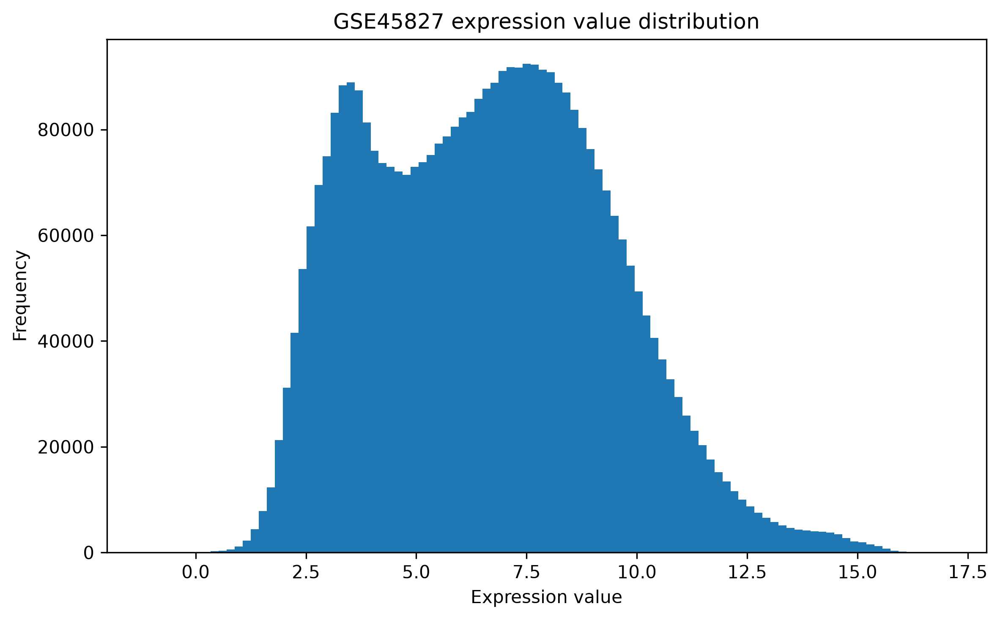
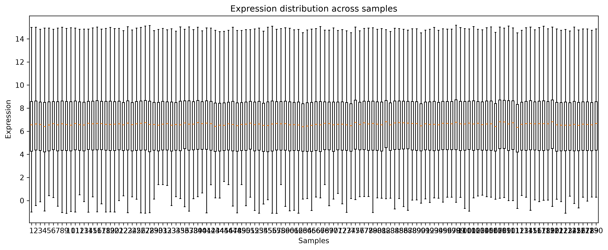
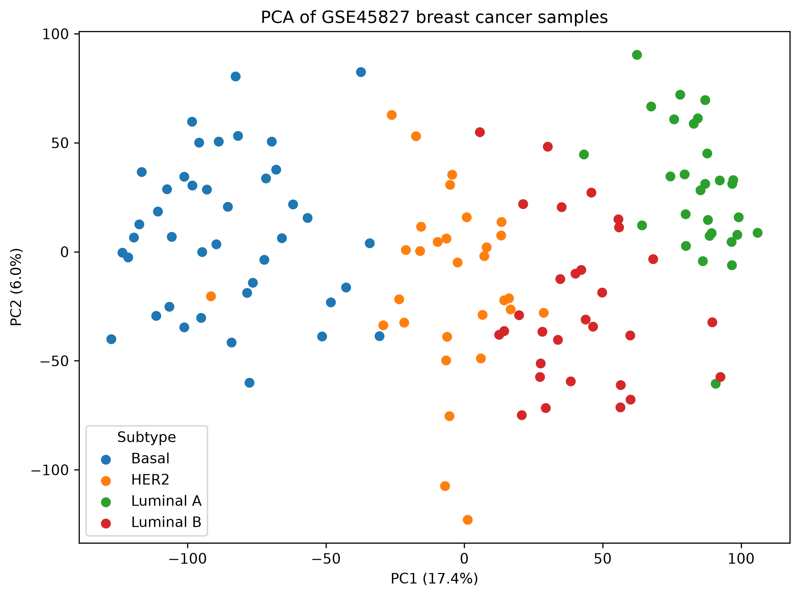
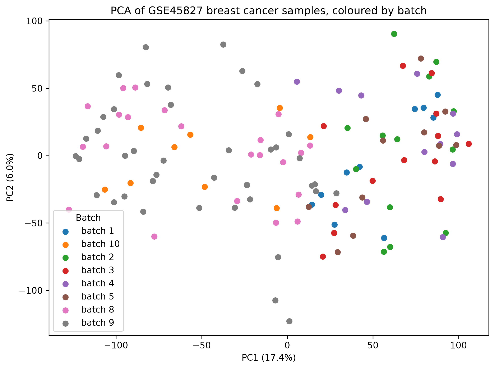
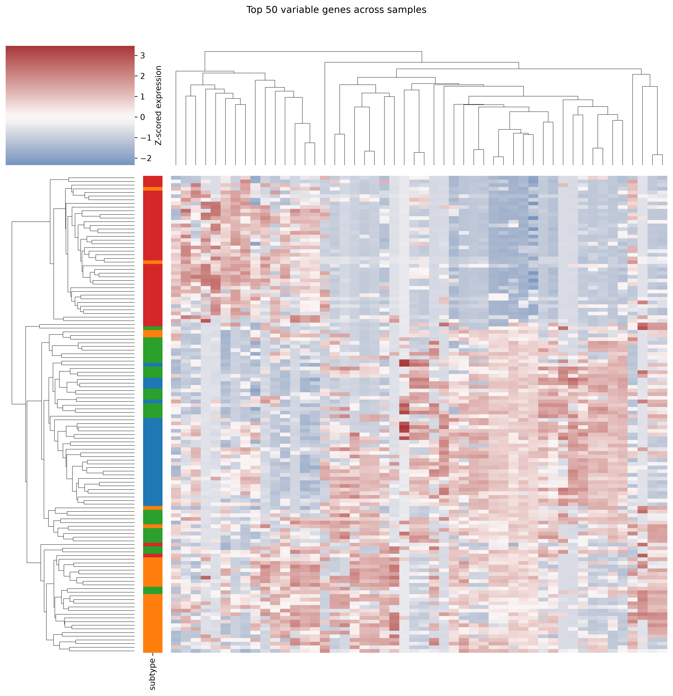
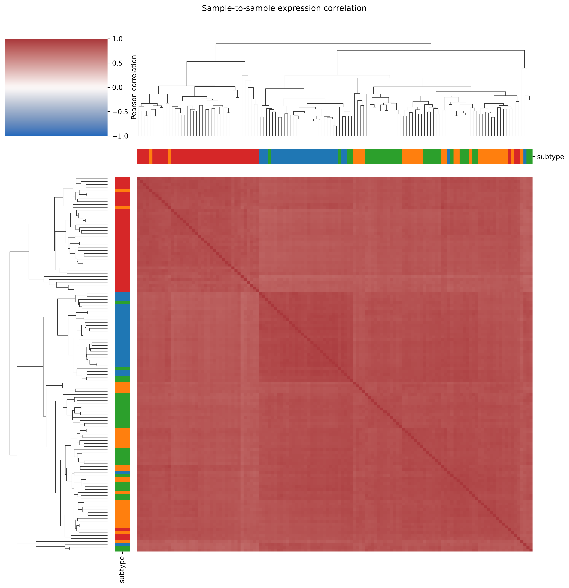

# Breast Cancer Transcriptomics

## Stage 1 — Data Acquisition, Cleaning & Exploration

### Goal

Acquire, clean, and explore breast cancer transcriptomic data from independent public cohorts as the foundation for downstream statistical analysis, biological interpretation, and machine learning.

---

## 1. Dataset Acquisition

### GEO: GSE45827

**Dataset:** `GSE45827_series_matrix.txt.gz`

**Source:** NCBI Gene Expression Omnibus (GEO)

**Accession:** GSE45827

**Title:** Expression data from Breast cancer subtypes

**Platform:** Affymetrix Human Genome U133 Plus 2.0 Array

**Experiment type:** Expression profiling by array

**Study design:** Primary invasive breast cancer samples collected at surgery before treatment.

The original cohort contains:

- 41 triple-negative/basal samples
- 30 HER2 samples
- 29 Luminal A samples
- 30 Luminal B samples
- 11 normal tissue samples
- 14 cell lines

### Original study design

> In a cohort study of primary invasive breast cancer (41 TN, 30 HER2, 29 Luminal A and 30 Luminal B) as well as 11 normal tissues samples and 14 cell lines, a tumor specimen at surgery before any patient treatment was obtained. Total RNA was extracted from all samples and the whole transcriptome was quantified with Affymetrix U133 Plus 2.0 Chips.

---

## 2. Raw Data Inspection

Inspected the GEO Series Matrix file to understand its structure and identify:

- Sample-level metadata
- GEO sample accession numbers
- Molecular subtype annotations
- Technical batch variables (processing `batch`, `hybridization`)
- Expression matrix boundaries
- Non-tumour samples and samples without molecular subtype annotations

---

## 3. Sample Metadata Extraction

Extracted GEO sample accession numbers, molecular subtype annotations, and two technical batch variables (processing `batch` and `hybridization`) from the GEO sample characteristics.

The molecular subtypes used for the analysis cohort are:

- Basal
- HER2
- Luminal A
- Luminal B

The `HER2` label was normalised from the source value `Her2` to the conventional uppercase form.

The metadata extraction and cohort filtering are implemented in:

`stage01/01_dataset_exploration.py`

---

## 4. Metadata Cleaning

The extracted metadata were cleaned by:

- Removing GEO quotation marks from sample IDs and characteristic labels
- Extracting the molecular subtype, processing batch, and hybridization from the sample characteristics
- Normalising the `Her2` label to `HER2`
- Excluding samples without one of the four molecular subtype labels
- Verifying that sample IDs are unique
- Verifying that all retained samples have valid subtype, batch, and hybridization annotations

---

## 5. Analysis Cohort

After filtering, the analysis cohort contains **130 breast cancer samples**:

| Molecular subtype | Samples |
|---|---:|
| Basal | 41 |
| HER2 | 30 |
| Luminal A | 29 |
| Luminal B | 30 |
| **Total** | **130** |

The cleaned metadata are stored in:

`data/GSE45827_metadata.csv`

---

## 6. Expression Data

The expression matrix was extracted from the GEO Series Matrix file and restricted to the 130 samples in the analysis cohort.

The resulting matrix contains:

- **29,873 Affymetrix probe features**
- **130 breast cancer samples**
- **0 missing expression values**

The expression matrix contains Affymetrix probe IDs in `ID_REF` and sample-level expression values in the remaining columns.

The expression extraction and validation are implemented in:

`stage01/02_expression.py`

The processed expression matrix is stored in:

`data/GSE45827_expression.csv`

### Expression/metadata validation

Verified that:

- All 130 metadata samples are present in the expression matrix
- Expression matrix columns match the metadata sample IDs exactly
- Probe IDs are unique
- No expression values are missing

---

## 7. Exploratory Data Analysis

Exploratory analysis was performed on the cleaned expression matrix.

### 7.1 Expression value distribution

The overall expression value distribution was examined using a histogram.

Expression values were predominantly distributed within an approximately **2–11** range, with a tail extending toward approximately 15.

Combined with the sample-level distributions, this is consistent with a processed microarray expression matrix rather than raw sequencing counts.

No additional log transformation was applied during this stage.

### 7.2 Sample-level expression distributions

Boxplots were used to compare expression distributions across the 130 samples.

The sample distributions were broadly consistent, with similar medians and interquartile ranges across samples. No sample showed an obvious global distributional shift requiring immediate exclusion.

### 7.3 Outlier detection

Per-sample mean expression was summarised and converted to a z-score. Samples with `|z| > 3` were flagged as potential outliers.

**Result:** One sample (`GSM1116220`, Luminal A) was flagged with a z-score of **-3.44**, reflecting a modest downward shift in mean expression. This is a single mild outlier and was retained for downstream analysis, but is noted as a sample worth watching in subsequent stages.

### 7.4 Batch-variable assessment

The cohort carries two technical batch variables from the source study: processing `batch` (1–10) and `hybridization` (-1, 1, 2, 3).

These variables are **strongly confounded with subtype**:

| | Basal / HER2 | Luminal A / Luminal B |
|---|---|---|
| `batch` | 8, 9, 10 | 1, 2, 3, 4, 5 |
| `hybridization` | -1 | 1, 2, 3 |

Basal and HER2 samples were processed in batches 8–10 with hybridization label -1, while Luminal samples were processed in batches 1–5 with hybridization labels 1–3. There is **no overlap** between the Basal/HER2 and Luminal batch groups.

This is a critical caveat: the strong transcriptional separation observed between Basal/HER2 and Luminal subtypes (see PCA below) is *partially confounded* with these technical variables and cannot be attributed to biology alone at this stage. This confounding must be carried forward and addressed in the differential-expression and robustness stages (Stages 2 and 7).

### 7.5 Low-variance filtering

For exploratory PCA and downstream analyses, genes/probes with very low variance across samples were removed.

A variance threshold of **0.1** was applied:

| | Features | Samples |
|---|---:|---:|
| Before filtering | 29,873 | 130 |
| After filtering | 28,086 | 130 |

This filtering was used specifically to reduce uninformative low-variance features.

### 7.6 Principal Component Analysis

PCA was performed on the variance-filtered expression matrix.

The first two principal components explained:

| Component | Variance explained |
|---|---:|
| PC1 | **17.4%** |
| PC2 | **6.0%** |
| PC1 + PC2 | **23.4%** |

The PCA revealed clear transcriptional structure corresponding to breast cancer molecular subtype.

In particular, Basal samples showed strong separation from the other subtypes along PC1, while Luminal A, Luminal B, and HER2 samples showed varying degrees of overlap.

This provides initial evidence that the expression matrix captures biologically meaningful molecular subtype structure. However, as noted in §7.4, the Basal/HER2 vs Luminal separation coincides with the batch variable, so this structure is not yet attributable to biology alone.

### 7.7 Heatmap of top variable genes

The 50 most variable probes were selected and their expression values were z-scored across samples and visualised as a clustered heatmap.

The heatmap recapitulates the PCA structure: samples cluster into coherent subtype-associated groups, with Basal samples forming a distinct block consistent with their strong separation along PC1.

### 7.8 Sample correlation

A sample-by-sample Pearson correlation matrix was computed and clustered.

Samples showed high within-subtype correlation and clear subtype-associated block structure, further confirming that the dominant source of variance in the dataset is subtype-related (with the batch caveat above).

The QC and PCA analysis are implemented in:

`stage01/03_expression_qc.py`

---

## 8. Stage 1 Interpretation

The initial exploratory analysis indicates that:

1. The GEO Series Matrix can be successfully parsed into a clean expression matrix and corresponding subtype, batch, and hybridization metadata.
2. The 130-sample breast cancer cohort has complete expression data.
3. Sample-level expression distributions are broadly consistent, with one mild low-expression outlier (GSM1116220).
4. Low-variance filtering removes a relatively small proportion of features (1,787 of 29,873).
5. PCA reveals strong molecular structure associated with breast cancer subtype, particularly the separation of Basal samples.
6. **Caveat:** the Basal/HER2 vs Luminal separation is confounded with processing batch and hybridization, so the observed structure must be validated against this technical variable in later stages.

These findings support proceeding to **differential expression analysis**, while explicitly carrying forward the batch-confounder caveat.

---

## 9. Figures

### Expression value distribution

**Figure 1.** Distribution of all expression values across the 130-sample cohort. The approximately 2–11 range with a tail toward 15 is consistent with a pre-processed (log-scale) microarray matrix rather than raw counts.

### Sample-level expression distributions

**Figure 2.** Per-sample expression distributions (boxplots, outliers suppressed) across the 130 samples. Medians and interquartile ranges are broadly consistent, indicating no gross technical outliers; the single mild outlier GSM1116220 (Luminal A) is flagged in §7.3.

### PCA by molecular subtype

**Figure 3.** Principal component analysis of 130 GSE45827 breast cancer samples using variance-filtered expression features. Samples are coloured according to molecular subtype. PC1 explains 17.4% of the variance and PC2 explains 6.0%. Basal samples separate along PC1, while Luminal and HER2 samples overlap more.

### PCA coloured by processing batch

**Figure 4.** The same PCA projection coloured by processing batch. Batches 8–10 (Basal/HER2) separate from batches 1–5 (Luminal), demonstrating that the dominant subtype axis is confounded with a technical batch variable. This must be addressed before attributing the separation to biology.

### Heatmap of top 50 variable genes

**Figure 5.** Clustered heatmap of the 50 most variable probes (z-scored across samples). Samples (rows) and genes (columns) are hierarchically clustered; the row colour bar indicates subtype. Coherent subtype blocks recapitulate the PCA structure.

### Sample correlation heatmap

**Figure 6.** Sample-by-sample Pearson correlation matrix, clustered and annotated by subtype (colour bars). High within-subtype correlation confirms that subtype-associated structure dominates the dataset.

---

## Stage 1 Status

- [x] Acquire GEO dataset
- [x] Inspect raw GEO structure
- [x] Extract sample IDs
- [x] Extract molecular subtype metadata
- [x] Extract batch and hybridization technical variables
- [x] Normalise `Her2` to `HER2`
- [x] Clean metadata
- [x] Define analysis cohort
- [x] Save cleaned metadata
- [x] Extract expression matrix
- [x] Validate expression/metadata sample matching
- [x] Check missing expression values
- [x] Check probe ID uniqueness
- [x] Examine expression value distribution
- [x] Examine sample-level expression distributions
- [x] Perform outlier detection
- [x] Assess batch-variable confounding
- [x] Perform low-variance filtering for exploratory PCA
- [x] Perform PCA
- [x] Examine PCA by molecular subtype
- [x] Examine PCA by batch
- [x] Generate heatmap of top variable genes
- [x] Generate sample correlation heatmap

---

## Next Stage

### Stage 2 — Differential Expression

The next stage will identify genes differentially expressed between breast cancer molecular subtypes.

Planned comparisons include:

- Basal vs Luminal A
- Basal vs HER2
- Basal/TNBC vs non-Basal subtypes

The analysis will introduce:

- Log2 fold change
- Statistical significance testing
- Multiple-testing correction
- False discovery rate (FDR)
- Volcano plots
- Differential expression tables
- Heatmaps of significant genes

**Carry-forward note:** the batch/hybridization confounding identified here must be considered when interpreting Stage 2 results.
