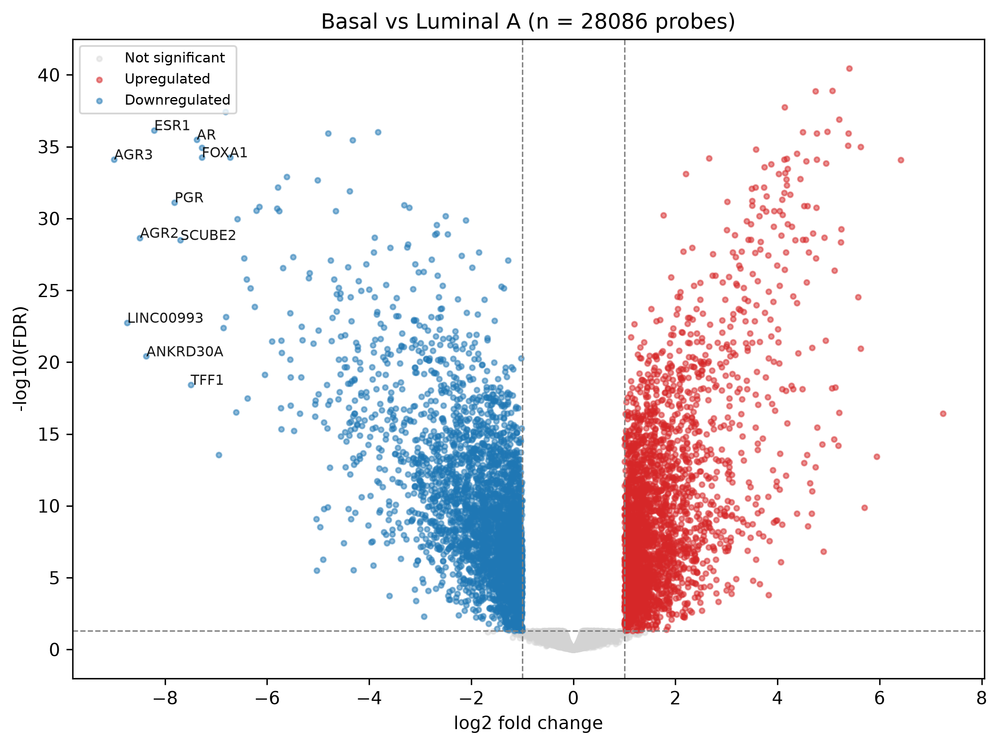
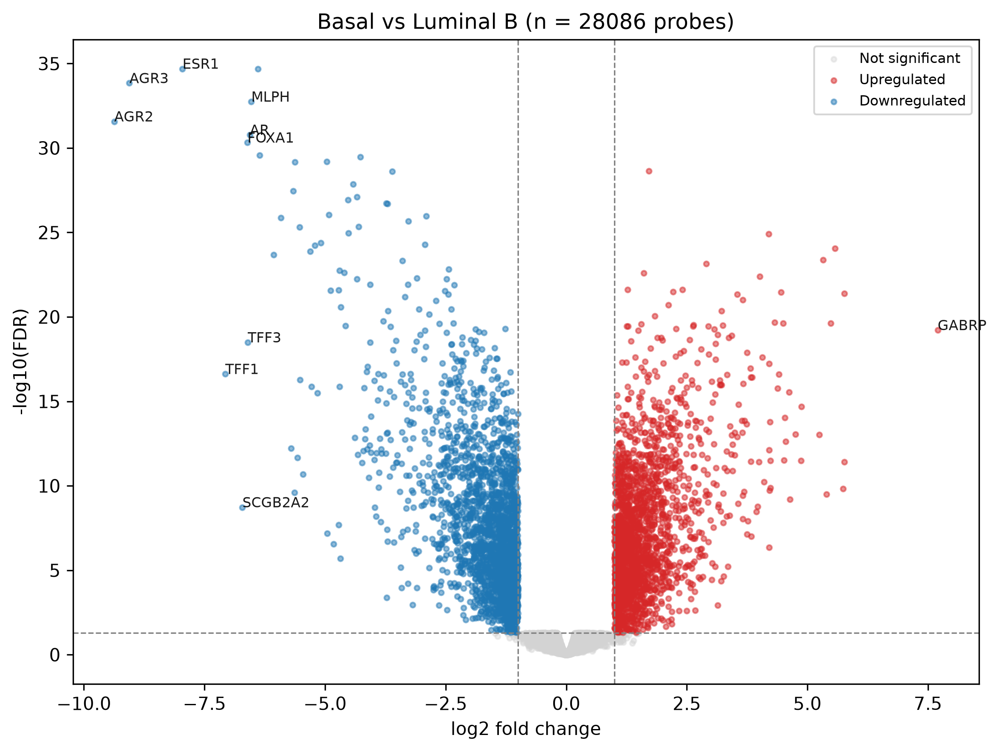
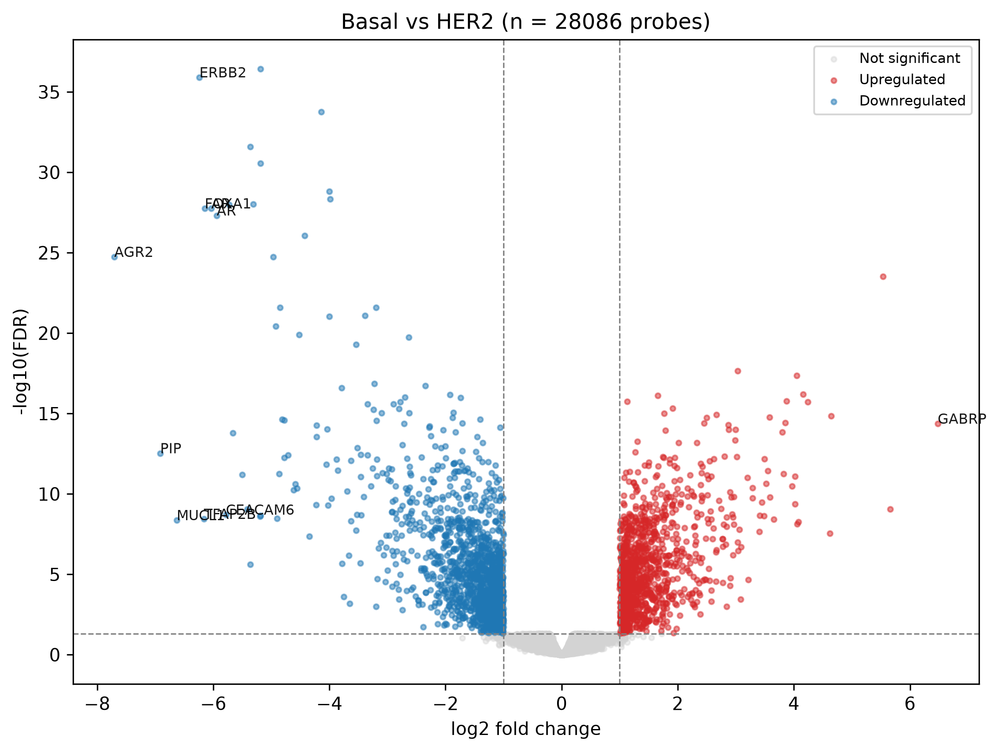
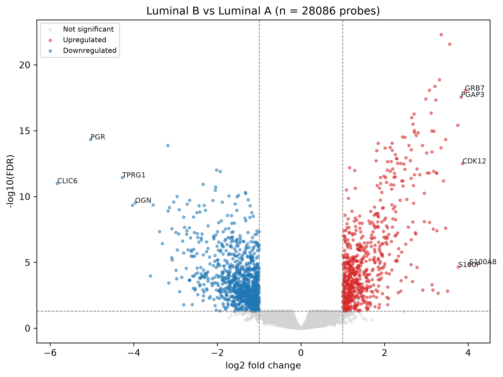
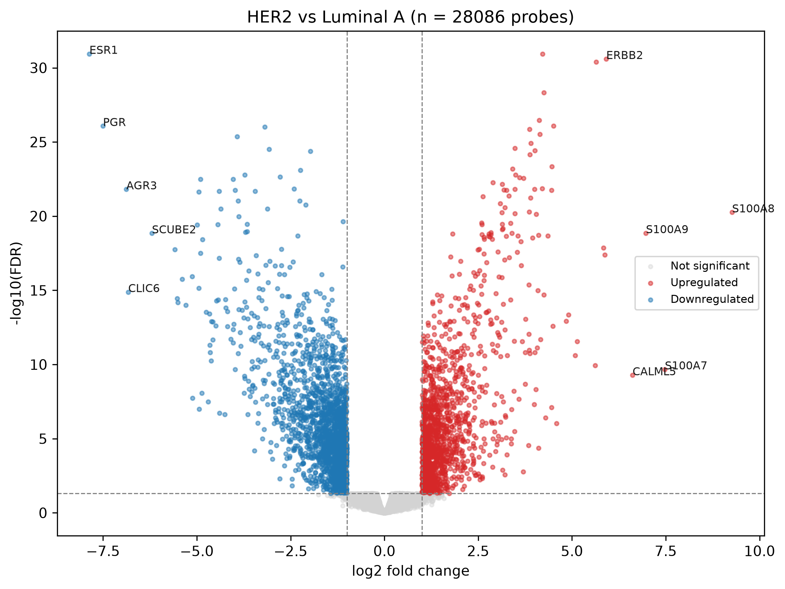
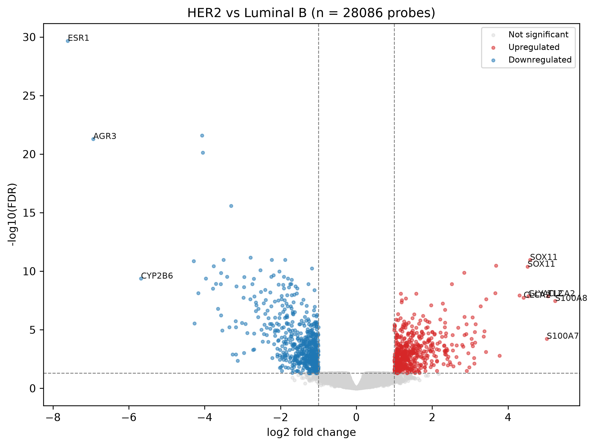
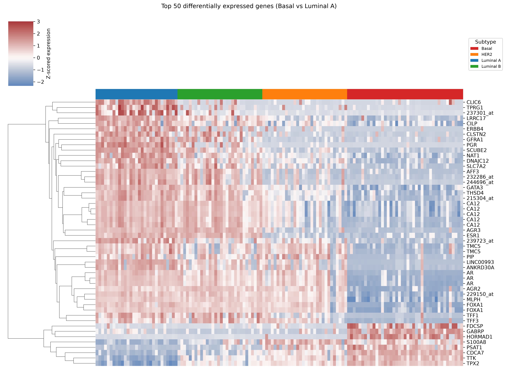

# Stage 2 — Differential Expression & Probe Annotation

## Research Question

Which genes and transcriptional features distinguish the major molecular subtypes of breast cancer, with particular emphasis on the basal-like phenotype compared with Luminal A, Luminal B, and HER2-enriched tumors?

## Methods

<<<<<<< HEAD
<<<<<<< HEAD
- Analyzed the GSE45827 breast cancer expression dataset containing 130 tumor samples across four molecular subtypes: Basal (n=41), HER2 (n=30), Luminal A (n=29), and Luminal B (n=30).
- Applied a low-variance filter, retaining 28,086 of 29,873 Affymetrix probes for differential-expression analysis.
- Used the `limma` empirical-Bayes framework with a no-intercept design (`~ 0 + subtype`) and six pairwise contrasts.
- Controlled for multiple testing using the Benjamini–Hochberg false-discovery rate (FDR).
- Annotated Affymetrix probes using `hgu133plus2.db`, retaining multiple valid gene mappings rather than arbitrarily selecting a single annotation.
- Generated volcano plots and a top-50-gene heatmap with a reproducible Python script (`03_volcano_heatmap.py`).

## Results

Differential expression was extensive across all subtype comparisons. The strongest signal was observed between Basal and Luminal A tumors.

| Contrast | Probes tested | FDR < 0.05 | FDR < 0.05 & \|log2FC\| ≥ 1 | Up | Down |
|---|---:|---:|---:|---:|---:|
| Basal vs Luminal A | 28,086 | 16,959 | 5,969 | 2,711 | 3,258 |
| Basal vs Luminal B | 28,086 | 14,414 | 4,208 | 2,003 | 2,205 |
| Basal vs HER2 | 28,086 | 9,926 | 2,451 | 1,086 | 1,365 |
| Luminal B vs Luminal A | 28,086 | 7,159 | 1,671 | 659 | 1,012 |
| HER2 vs Luminal A | 28,086 | 11,345 | 3,243 | 1,382 | 1,861 |
| HER2 vs Luminal B | 28,086 | 4,649 | 1,110 | 525 | 585 |

"Up" and "Down" indicate the direction in the first-named subtype (e.g., 2,711 genes up-regulated in Basal relative to Luminal A).

The full per-contrast results are stored in `results/DE_*_annotated.csv` (gitignored, regenerable via `01_de_analysis.R` and `02_annotate_probes.R`). A compact, committed summary of the top 50 genes per contrast is available in `results/top_DEGs_per_contrast.csv`.

## Figures

### Volcano plots



**Figure 1.** Volcano plot of Basal vs Luminal A. Each point is a probe; red and blue points are significant (FDR < 0.05) with |log2FC| ≥ 1, up- and down-regulated in Basal respectively. The strongest effects are proliferation genes up in Basal (e.g. TPX2, KIF2C) and hormone-signaling genes down in Basal (e.g. ESR1, PGR, AGR2).



**Figure 2.** Volcano plot of Basal vs Luminal B.



**Figure 3.** Volcano plot of Basal vs HER2.



**Figure 4.** Volcano plot of Luminal B vs Luminal A.



**Figure 5.** Volcano plot of HER2 vs Luminal A.



**Figure 6.** Volcano plot of HER2 vs Luminal B.

### Heatmap of top 50 differentially expressed genes



**Figure 7.** Heatmap of the 50 most-changed genes (by |log2FC|) from the Basal vs Luminal A contrast, z-scored across the 130 samples. Columns (samples) are ordered by subtype (colour bar). Two coherent gene blocks emerge: a proliferation/mitosis module up-regulated in Basal and a hormone-signaling module up-regulated in Luminal subtypes.

## Biological interpretation

The direction of effect was biologically coherent and recapitulates known breast cancer biology:

- **Basal-like tumors** over-express proliferation and mitosis genes (e.g. TPX2, KIF2C, KIF14, AURKB, CCNB1, MKI67), consistent with their aggressive, highly proliferative phenotype.
- **Luminal tumors** over-express hormone-signaling genes (e.g. ESR1, PGR, AGR2, AGR3, FOXA1, GATA3), consistent with estrogen-receptor-driven disease.
- **HER2-enriched tumors** show a distinct signature related to growth-factor signaling.

These findings are expected for transcriptionally well-separated subtypes, but they establish the gene-level foundation for the pathway analysis in Stage 3.

## Limitations

1. **Batch confounding.** As documented in Stage 1 (§7.4), the processing `batch` and `hybridization` variables are almost perfectly confounded with subtype: Basal and HER2 samples were processed in batches 8–10 (hybridization -1), while Luminal samples were processed in batches 1–5 (hybridization 1–3). The Basal/HER2 vs Luminal contrasts are therefore **partially confounded with a technical variable** and cannot be attributed to biology alone. The batch-clean contrasts are Basal vs HER2 (both batches 8–10) and Luminal A vs Luminal B (both batches 1–5).

2. **Probe-to-gene mapping.** Multiple probes map to the same gene, and some probes map to multiple genes (retained as `;`-separated symbols). The analysis is at the probe level; gene-level aggregation is deferred to Stage 3.

3. **"Basal" is not synonymous with clinical TNBC.** The Basal subtype is defined transcriptomically here; it should not be equated with clinically confirmed triple-negative breast cancer in the absence of receptor-status information.

4. **Association, not causation.** Differential expression identifies transcriptional differences; it does not establish mechanism or treatment-response biomarkers.

## Significance

Breast cancer is transcriptionally heterogeneous, and molecular subtype captures major differences in tumor biology and therapeutic vulnerability. Characterizing subtype-associated transcriptional programs provides a foundation for identifying biological pathways (Stage 3) and, later, investigating immune biology and potential determinants of treatment response.

---

## Analysis details

### 1. Dataset
=======
=======
>>>>>>> main
* Analyzed the GSE45827 breast cancer expression dataset containing 130 tumor samples across four molecular subtypes: Basal (n=41), HER2 (n=30), Luminal A (n=29), and Luminal B (n=30).
* Applied a low-variance filter, retaining 28,086 of 29,873 Affymetrix probes for differential-expression analysis.
* Used the limma empirical-Bayes framework to perform six pairwise subtype comparisons.
* Controlled for multiple testing using the Benjamini–Hochberg false-discovery rate (FDR).
* Annotated Affymetrix probes using `hgu133plus2.db`, retaining multiple valid gene mappings rather than arbitrarily selecting a single annotation.

## Findings

Differential expression was extensive across breast cancer subtypes. The strongest signal was observed between Basal and Luminal A tumors, with 16,959 probes reaching FDR < 0.05 and 5,969 meeting both FDR < 0.05 and |log2FC| ≥ 1.


The volcano plots demonstrate substantial transcriptional separation between the molecular subtypes. The direction of effect was biologically coherent; for example, ESR1 showed substantially lower expression in Basal relative to Luminal A tumors, consistent with the expected hormone-receptor-associated biology of luminal disease.

## Significance

Breast cancer is transcriptionally heterogeneous, and molecular subtype captures major differences in tumor biology and therapeutic vulnerability. Characterizing subtype-associated transcriptional programs provides a foundation for identifying biological pathways associated with the basal-like phenotype and, later, investigating immune biology and potential determinants of treatment response.

Importantly, the present analysis identifies transcriptional differences rather than establishing causal mechanisms or treatment-response biomarkers.

---

# Analysis details

The three primary comparisons were:

* Basal vs Luminal A
* Basal vs Luminal B
* Basal vs HER2

Three additional pairwise comparisons were performed to characterize the broader subtype structure:

* Luminal B vs Luminal A
* HER2 vs Luminal A
* HER2 vs Luminal B

Here, "Basal" refers to the molecular subtype defined in the source dataset. It should not be treated as synonymous with clinically confirmed triple-negative breast cancer (TNBC) in the absence of corresponding clinical receptor-status information.

## 2. Dataset
<<<<<<< HEAD
>>>>>>> main
=======
>>>>>>> main

The analysis uses GEO accession **GSE45827**, an Affymetrix Human Genome U133 Plus 2.0 expression dataset containing breast cancer molecular subtypes.

The tumor cohort analyzed here contains:

| Molecular subtype | Samples |
| ----------------- | ------: |
| Basal             |      41 |
| HER2              |      30 |
| Luminal A         |      29 |
| Luminal B         |      30 |
| **Total**         | **130** |

<<<<<<< HEAD
<<<<<<< HEAD
The dataset also contains normal and cell-line samples in the original study; these were not included in the tumor subtype differential-expression analysis.

### 2. Expression preprocessing

The expression matrix contained:

- 29,873 Affymetrix probes
- 130 tumor samples
- no missing expression values
- unique sample and probe identifiers

A variance filter of `variance > 0.1` was applied before differential-expression analysis, retaining **28,086 probes** (removing 1,787 low-variance probes).

The expression values were already on an approximately log-scale, so no additional log transformation was applied.

### 3. Statistical model
=======
=======
>>>>>>> main
The dataset also contains other sample types in the original study; these were not included in the tumor subtype differential-expression analysis.

## 3. Expression preprocessing

The expression matrix contained:

* 29,873 Affymetrix probes
* 130 tumor samples
* no missing expression values
* unique sample and probe identifiers

A variance filter of:

```text
variance > 0.1
```

was applied before differential-expression analysis.

This retained:

```text
28,086 probes
```

and removed 1,787 low-variance probes.

The expression values were already on an approximately log-scale, so no additional log transformation was applied.

## 4. Statistical model
<<<<<<< HEAD
>>>>>>> main
=======
>>>>>>> main

Differential expression was performed using the Bioconductor `limma` package.

A no-intercept design matrix was used:

```text
~ 0 + subtype
```

<<<<<<< HEAD
<<<<<<< HEAD
with four subtype coefficients (`Luminal A`, `Luminal B`, `HER2`, `Basal`), and six pairwise contrasts:
=======
=======
>>>>>>> main
with four subtype coefficients:

```text
Luminal A
Luminal B
HER2
Basal
```

Pairwise contrasts were then constructed between these coefficients.

The six contrasts were:
<<<<<<< HEAD
>>>>>>> main
=======
>>>>>>> main

```text
Basal - Luminal A
Luminal B - Luminal A
HER2 - Luminal A
Basal - Luminal B
HER2 - Luminal B
Basal - HER2
```

<<<<<<< HEAD
<<<<<<< HEAD
Positive log2 fold-change therefore indicates higher expression in the first-named subtype.

### 4. Multiple-testing correction

For each contrast, limma's moderated t-statistics were calculated using empirical-Bayes variance moderation. P-values were adjusted using the Benjamini–Hochberg procedure.
=======
=======
>>>>>>> main
Positive log2 fold-change therefore indicates higher expression in the first subtype named in the contrast.

## 5. Multiple-testing correction

For each contrast, limma's moderated t-statistics were calculated using empirical-Bayes variance moderation.

P-values were adjusted using the Benjamini–Hochberg procedure.
<<<<<<< HEAD
>>>>>>> main
=======
>>>>>>> main

Two significance criteria were used:

```text
FDR < 0.05
```

and the more stringent combined criterion:

```text
FDR < 0.05
|log2FC| >= 1
```

<<<<<<< HEAD
<<<<<<< HEAD
The latter was used to identify genes showing both statistical evidence and a minimum effect size.

### 5. Probe annotation

Probes were annotated using the `hgu133plus2.db` Bioconductor annotation package, mapping probe IDs to `SYMBOL`, `ENTREZID`, `ENSEMBL`, and `GENENAME`. Where a probe mapped to multiple genes, all mappings were retained (collapsed with `;`) rather than arbitrarily selecting a single annotation.

---

## Reproducibility

```text
Rscript stage02/01_de_analysis.R       # fit limma model, write DE tables
Rscript stage02/02_annotate_probes.R  # annotate probes
python stage02/03_volcano_heatmap.py  # volcano plots + heatmap
python stage02/04_top_genes.py         # curated top-genes table
```

Note: Steps 1–2 require an R environment with Bioconductor (see `renv.lock`); steps 3–4 run in the project Python environment.

---

## Next Stage

### Stage 3 — Pathway Enrichment

Map the subtype-specific differentially expressed genes onto biological pathways (GO, KEGG, MSigDB Hallmark) to interpret what these transcriptional programs actually do — moving from "which genes changed" to "what do these genes do".

**Carry-forward caveat:** the batch/hybridization confounding identified in Stage 1 must be considered when interpreting the pathway results, especially for the Basal/HER2 vs Luminal contrasts.
=======
The latter was used to identify genes showing both statistical evidence and a minimum effect
>>>>>>> main
=======
The latter was used to identify genes showing both statistical evidence and a minimum effect
>>>>>>> main
