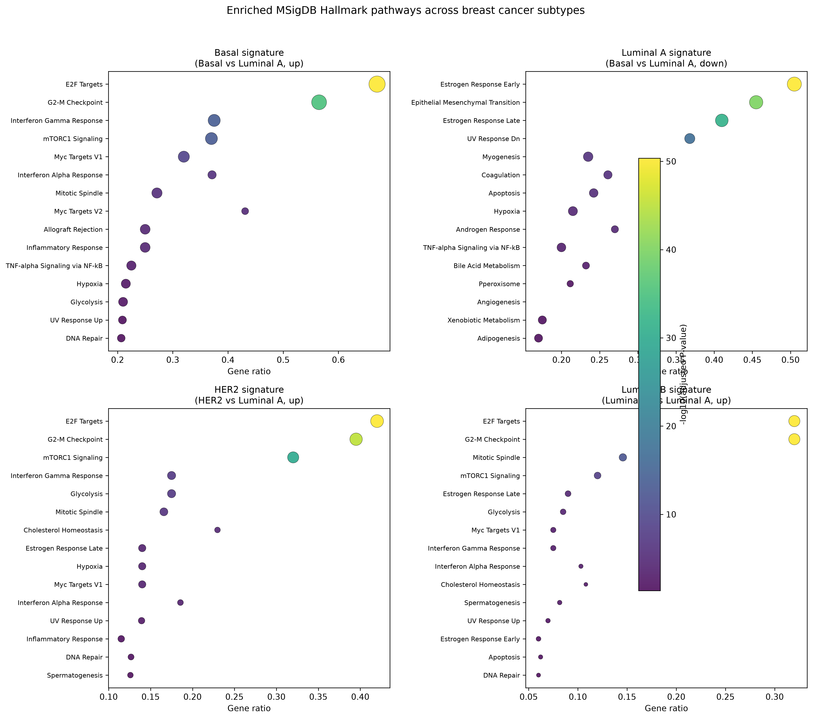
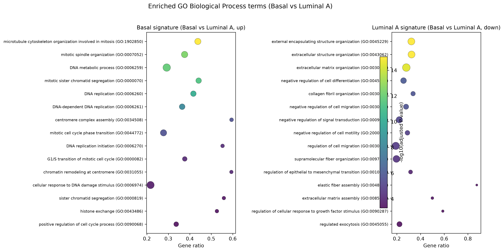
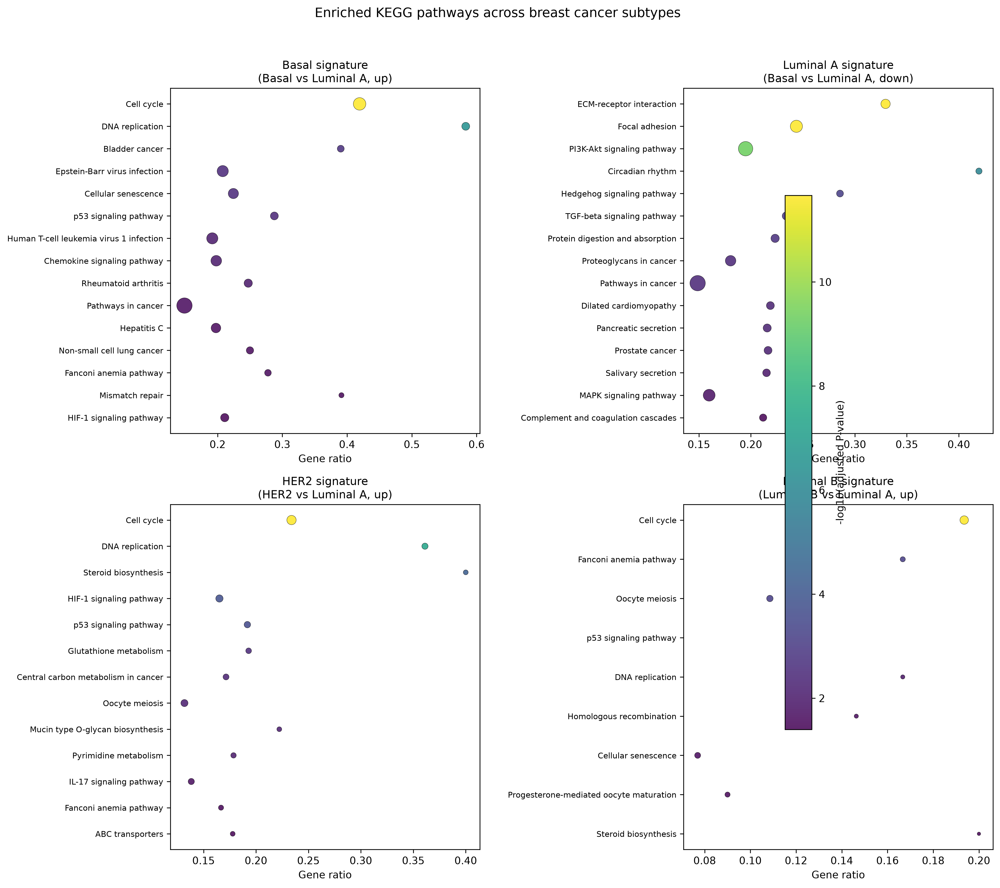

# Stage 3: Pathway Enrichment

## Research Question

What biological pathways and processes explain the transcriptional differences between breast cancer molecular subtypes identified in Stage 2?

## Methods

- Derived gene lists from the Stage 2 differential-expression results (FDR < 0.05, |log2FC| ≥ 1), collapsing Affymetrix probes to gene symbols and defining a background universe of 14,056 detected genes.
- Ran **over-representation analysis (ORA)** via `gseapy.enrichr()` against three gene-set libraries: Gene Ontology Biological Process (`GO_Biological_Process_2021`), KEGG (`KEGG_2021_Human`), and MSigDB Hallmark (`MSigDB_Hallmark_2020`).
- Ran **gene set enrichment analysis (GSEA)** via `gseapy.prerank()` on the log2FC-ranked gene list against the Hallmark collection, as an independent confirmation that does not rely on an arbitrary threshold.
- Significance threshold: adjusted P-value (Benjamini–Hochberg) < 0.05.

The subtype signatures are defined as genes up-regulated in each subtype relative to a reference:

| Signature | Contrast (direction) |
|---|---|
| Basal | Basal vs Luminal A (up) |
| Luminal A | Basal vs Luminal A (down) |
| HER2 | HER2 vs Luminal A (up) |
| Luminal B | Luminal B vs Luminal A (up) |

## Results

### Hallmark pathways across subtypes



**Figure 1.** Enriched MSigDB Hallmark pathways for each subtype signature (top 15 by adjusted P-value). Dot size reflects the number of overlapping genes and colour reflects significance (-log10 adjusted P-value). Basal tumors are driven by proliferation (E2F/G2M) and immune (interferon) programs; Luminal A by estrogen response; HER2 and Luminal B by proliferation and metabolic programs.

Top 5 enriched Hallmark pathways per subtype (full top-10 with all three libraries is in `results/top_pathways_per_subtype.csv`):

| Subtype | Pathway | Gene count | Adj. P-value |
|---|---|---|---:|
| Basal | E2F Targets | 134/200 | 3.5e-85 |
| Basal | G2-M Checkpoint | 113/200 | 2.9e-60 |
| Basal | Interferon Gamma Response | 75/200 | 5.9e-25 |
| Basal | mTORC1 Signaling | 74/200 | 2.5e-24 |
| Basal | Myc Targets V1 | 64/200 | 2.2e-17 |
| Luminal A | Estrogen Response Early | 101/200 | 1.4e-45 |
| Luminal A | Epithelial Mesenchymal Transition | 91/200 | 1.4e-36 |
| Luminal A | Estrogen Response Late | 82/200 | 3.8e-29 |
| Luminal A | UV Response Dn | 53/144 | 1.6e-16 |
| Luminal A | Myogenesis | 47/200 | 3.4e-07 |
| HER2 | E2F Targets | 84/200 | 2.0e-53 |
| HER2 | G2-M Checkpoint | 79/200 | 5.0e-48 |
| HER2 | mTORC1 Signaling | 64/200 | 1.5e-32 |
| HER2 | Interferon Gamma Response | 35/200 | 1.6e-09 |
| HER2 | Glycolysis | 35/200 | 1.6e-09 |
| Luminal B | G2-M Checkpoint | 64/200 | 4.4e-51 |
| Luminal B | E2F Targets | 64/200 | 4.4e-51 |
| Luminal B | Mitotic Spindle | 29/199 | 5.2e-13 |
| Luminal B | mTORC1 Signaling | 24/200 | 4.1e-09 |
| Luminal B | Estrogen Response Late | 18/200 | 3.8e-05 |

### GO Biological Process (Basal vs Luminal A)



**Figure 2.** Top enriched GO Biological Process terms for the Basal (left) and Luminal A (right) signatures. Basal is enriched for mitotic cell-cycle and DNA-replication terms; Luminal A for hormone and cell-adhesion terms.

### KEGG pathways



**Figure 3.** Enriched KEGG pathways across subtypes. Basal, HER2, and Luminal B are enriched for cell-cycle and DNA-replication pathways; Luminal A for focal adhesion, ECM-receptor interaction, and PI3K-Akt signaling.

Top 5 enriched KEGG pathways per subtype:

| Subtype | Pathway | Gene count | Adj. P-value |
|---|---|---|---:|
| Basal | Cell cycle | 52/124 | 1.2e-18 |
| Basal | DNA replication | 21/36 | 1.1e-10 |
| Basal | Bladder cancer | 16/41 | 6.3e-05 |
| Basal | Epstein-Barr virus infection | 42/202 | 1.3e-04 |
| Basal | Cellular senescence | 35/156 | 1.3e-04 |
| Luminal A | Focal adhesion | 49/201 | 8.4e-07 |
| Luminal A | ECM-receptor interaction | 29/88 | 8.4e-07 |
| Luminal A | PI3K-Akt signaling pathway | 69/354 | 9.7e-06 |
| Luminal A | Circadian rhythm | 13/31 | 3.4e-04 |
| Luminal A | Hedgehog signaling pathway | 16/56 | 6.3e-03 |
| HER2 | Cell cycle | 29/124 | 1.2e-09 |
| HER2 | DNA replication | 13/36 | 1.8e-06 |
| HER2 | Steroid biosynthesis | 8/20 | 3.4e-04 |
| HER2 | HIF-1 signaling pathway | 18/109 | 7.9e-04 |
| HER2 | p53 signaling pathway | 14/73 | 1.1e-03 |
| Luminal B | Cell cycle | 24/124 | 2.2e-12 |
| Luminal B | Oocyte meiosis | 14/129 | 6.8e-04 |
| Luminal B | Fanconi anemia pathway | 9/54 | 6.8e-04 |
| Luminal B | p53 signaling pathway | 9/73 | 6.1e-03 |
| Luminal B | DNA replication | 6/36 | 1.3e-02 |

## Biological interpretation

The enrichment results recapitulate the canonical breast cancer subtype biology:

- **Basal-like tumors** are driven by **proliferation** (E2F targets, G2-M checkpoint, mitotic spindle) and **immune signaling** (interferon gamma/alpha response). The interferon signal is notable: it reflects an immune-inflamed microenvironment, which is the biological rationale for why basal-like/TNBC is the subtype where immune checkpoint blockade is approved.
- **Luminal A tumors** are driven by **estrogen signaling** (estrogen response early/late, androgen response), consistent with hormone-receptor-positive, less-proliferative disease.
- **HER2-enriched tumors** are characterized by **proliferation plus metabolic programs** (E2F, G2M, mTORC1, glycolysis), consistent with the aggressive, growth-factor-driven biology of HER2 amplification.
- **Luminal B tumors** share the Luminal A estrogen program but add a **proliferation signature** (G2M, E2F, mitotic spindle), consistent with Luminal B being the more proliferative, higher-Ki67 luminal subtype.

### Method agreement

GSEA (which uses the full ranked gene list rather than a threshold) independently confirmed the ORA results. For Basal vs Luminal A, the top positive-enrichment Hallmark sets (up in Basal) were E2F Targets (NES = 3.47), G2-M Checkpoint (NES = 3.26), and Interferon Gamma Response (NES = 2.50); Estrogen Response Early was the strongest negatively-enriched set (NES = -2.79, i.e. up in Luminal A). This triangulation increases confidence that the results are robust to the choice of method.

## Clinical relevance

These pathway differences explain why the subtypes have distinct clinical behavior and treatment vulnerabilities:

- Basal/TNBC's proliferation + immune program underlies both its aggressiveness and its responsiveness to chemotherapy and immunotherapy.
- Luminal A's estrogen-dependence is the basis for endocrine therapy.
- HER2-enriched's growth-factor program is the basis for anti-HER2 therapy.

## Limitations

1. **Batch confounding.** As documented in Stages 1–2, the processing batch is confounded with the Basal/HER2 vs Luminal split. The Basal vs Luminal A and HER2 vs Luminal A signatures are therefore **partially confounded with a technical variable**. The batch-clean contrasts (Basal vs HER2, Luminal A vs Luminal B) provide the cleanest subtype-specific signal and should be emphasized in downstream interpretation.

2. **Enrichr background.** `enrichr()` uses Enrichr's fixed gene universe rather than our custom 14,056-gene background, which can introduce mild bias; this is a known limitation of the tool.

3. **Probe-to-gene collapse.** Multi-mapping probes were resolved by taking the maximum |log2FC| per gene, and `;`-separated multi-gene probes were expanded to all listed genes. This is a standard but imperfect resolution.

4. **Redundant GO terms.** GO Biological Process contains many overlapping parent/child terms; the top-ranked terms are illustrative but not independent.

## Reproducibility

```text
python stage03/01_prepare_gene_lists.py   # build gene lists + background
python stage03/02_enrichment.py           # ORA (enrichr) + GSEA (prerank)
python stage03/03_visualize.py            # dot plots
python stage03/04_top_pathways.py         # committed top-pathways summary
```

Step 2 requires network access to the Enrichr API.

## Next Stage

### Stage 4: Reproduce a Published Paper

Reproduce the subtype transcriptomic analysis from a published study (e.g., TCGA-BRCA, Nature 2012, or the PAM50 classifier paper) to validate the approach against the literature.
